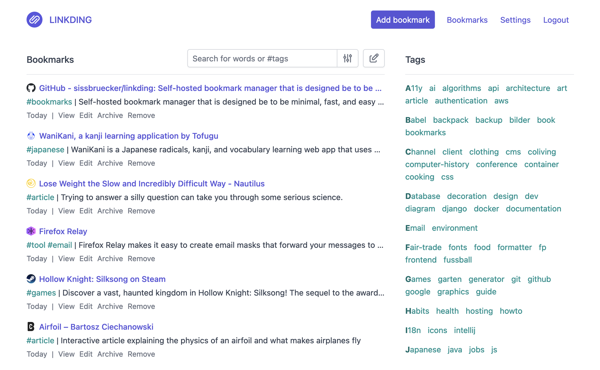

# Linkding

Self-hosted bookmark manager — minimal, fast, and easy to set up. Save links with tags, notes and read-it-later flags, search them instantly, share them with other users or guests, and automate it all through the REST API and browser extensions.

*Screenshot from the upstream linkding README ([sissbruecker/linkding](https://github.com/sissbruecker/linkding), MIT).*

## Source Repository

[https://github.com/INAPP-Mobile/linkding](https://github.com/INAPP-Mobile/linkding)

## Deploy and Host

Click **Deploy on Railway** above. One field on the deploy form: the admin password (generated for you). The admin user `admin` is created automatically on first boot — log in with the generated password, no email step, no setup wizard.

## Why Deploy

- **Your links, your server.** Bookmarks, tags and notes live in your own SQLite database on a Railway volume — no third-party bookmark service, no sync account.
- **Fast to find.** Full-text search over titles, descriptions and URLs, plus tag search and bulk editing.
- **Collects metadata for you.** Saving a bookmark fetches its title, description and favicon automatically in the background.
- **Automate it.** A REST API, RSS feeds, browser extensions for Firefox and Chrome, a bookmarklet, and Netscape HTML import/export.
- **Shareable.** Share bookmarks with other users or guests, or keep them private.

## Common Use Cases

- Personal read-it-later list with tags instead of a pile of open tabs
- Shared team link collection with per-user accounts
- Research bookmark archive with full-text search
- Backend for the linkding browser extension and mobile apps

## Configuration

| Variable | Default | What it does |
|---|---|---|
| `LD_SUPERUSER_PASSWORD` | `${{secret(16)}}` (deploy form) | Password for the auto-created `admin` user. |
| `LD_SUPERUSER_NAME` | `admin` (baked in) | Username of the auto-created admin user. |
| `LD_SERVER_PORT` | `$PORT` (derived on boot) | Port uwsgi listens on; Railway injects `PORT`. |
| `LD_CSRF_TRUSTED_ORIGINS` | `https://$RAILWAY_PUBLIC_DOMAIN` (derived on boot) | Trusted origin for Django CSRF checks behind the Railway proxy. |
| `LD_FAVICON_PROVIDER` | upstream default (Google) | Favicon service URL; DuckDuckGo alternative is `https://icons.duckduckgo.com/ip3/{domain}.ico`. |
| `LD_DISABLE_BACKGROUND_TASKS` | `False` | Set `True` to stop background metadata/snapshot tasks. |
| `LD_DISABLE_URL_VALIDATION` | `False` | Set `True` to allow non-HTTP(S) or non-FQDN bookmark URLs. |
| `LD_ALLOWED_INTERNAL_HOSTS` | unset | Comma-separated hosts allowed for metadata fetching (SSRF guard). |
| `LD_ENABLE_OIDC` / `OIDC_*` | unset | Optional OpenID Connect single sign-on (see upstream options docs). |
| `LD_ENABLE_AUTH_PROXY` | `False` | Optional auth-proxy (e.g. Authelia) login. |

Upstream options reference: https://linkding.link/options/

### Deployment Dependencies

- **Runtime:** Python 3.13 / Django, single service (uwsgi + background task worker)
- **Plan:** Hobby or above; ~150 MB RAM at rest
- **Port:** Railway-injected `PORT` (mapped to `LD_SERVER_PORT` on boot)
- **Persistence:** one Railway volume at `/etc/linkding/data` (SQLite database, secret key, favicons, previews)
- **Healthcheck:** `/health` (upstream's own probe, unauthenticated)
