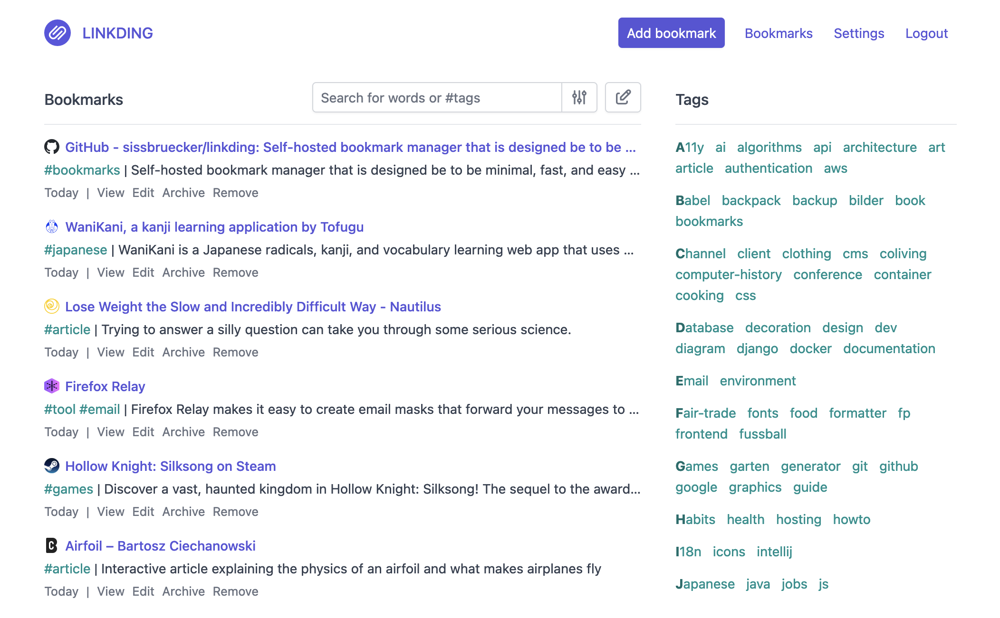

# Deploy and Host

Linkding is a self-hosted bookmark manager that is designed to be minimal, fast, and easy to set up. Deploy it on Railway in one click: the admin user is created automatically, your bookmarks live in SQLite on a persistent volume, and the REST API and browser extensions work out of the box.

## About Hosting

Linkding runs as a single lightweight service on Railway.

- **What gets deployed:** one Linkding service (Django + uwsgi, Python 3.13) with a background task worker for fetching bookmark metadata.
- **Database:** embedded SQLite — no companion database service needed.
- **Persistence:** one Railway volume at `/etc/linkding/data` holds the database, secret key, favicons and previews, so bookmarks survive redeploys.
- **First login:** user `admin` with the generated password from the deploy form. No email step, no setup wizard.

## Why Deploy

Your links live on your own server instead of a third-party bookmark service. Save a link and linkding fetches its title, description and favicon for you; tag it, add a note, mark it read-it-later, and find it again with full-text search. Share bookmarks with other users or guests, import and export Netscape HTML, and automate everything through the REST API, RSS feeds, or the Firefox and Chrome extensions.

## Common Use Cases

- Personal read-it-later list with tags instead of a pile of open tabs
- Shared team link collection with per-user accounts
- Research bookmark archive with full-text search
- Backend for the linkding browser extension and mobile apps

## Dependencies for Linkding

| Setting | Value |
|---|---|
| Runtime | Python 3.13 / Django, single service |
| Plan | Hobby or above |
| Port | Railway-injected `PORT` (mapped to `LD_SERVER_PORT` on boot) |
| Persistence | One volume at `/etc/linkding/data` |
| Healthcheck | `/health` (upstream probe, unauthenticated) |
| Deploy form | One field: admin password (generated) |

### Deployment Dependencies

- **Upstream:** [sissbruecker/linkding](https://github.com/sissbruecker/linkding) v1.47.0, MIT, pinned by digest
- **Admin account:** `admin`, auto-created on first boot from the generated deploy-form password
- **CSRF:** trusted origin derived on every boot from the live Railway public domain
- **Background tasks:** enabled by default (metadata scraping); disable with `LD_DISABLE_BACKGROUND_TASKS=True`
- **Optional:** OIDC single sign-on and auth-proxy login via upstream `LD_ENABLE_OIDC` / `LD_ENABLE_AUTH_PROXY` options
